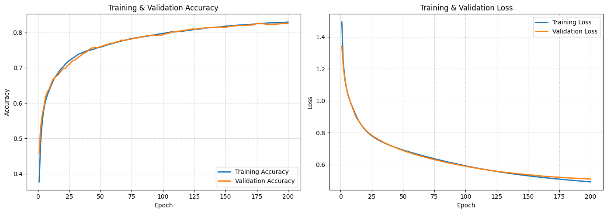
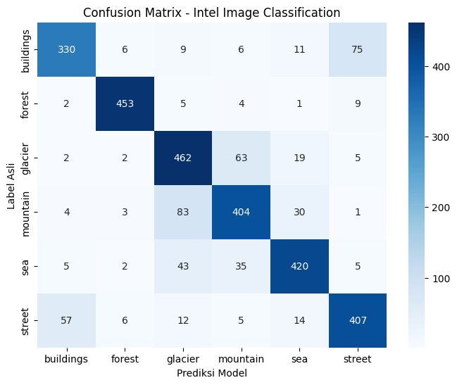

# CNN Accelerator for Natural Scene Classification on Intel DE10-Standard FPGA

## 1. Project Overview

| Parameter | Description |
|---|---|
| Project Name | CNN Accelerator for Natural Scene Classification |
| Target Hardware | Terasic DE10-Standard |
| FPGA Device | Intel Cyclone V SX (`5CSXFC6D6F31C6`) |
| Clock Frequency | 50 MHz |
| On-chip Memory | Approximately 680 KB M10K BRAM |
| DSP Blocks | 112 |
| Dataset | Intel Image Classification |
| Number of Classes | 6 |
| Current Status | Software pipeline completed; RTL implementation pending |

### Project Objectives

This project aims to develop a hardware-accelerated Convolutional Neural Network (CNN) for natural scene classification using the Intel DE10-Standard FPGA development board.

The CNN architecture is designed to be lightweight enough to fit within the FPGA's limited hardware resources, particularly its internal memory (BRAM) and Digital Signal Processing (DSP) blocks.

The hardware implementation is planned using Verilog HDL, followed by functional simulation with ModelSim and synthesis using Intel Quartus Prime.

### Development Progress

| Development Stage | Status |
|---|---|
| Dataset preparation | Completed |
| Research-based feature extraction experiments | Completed |
| CNN architecture design | Completed |
| CNN model training | Completed |
| Confusion Matrix evaluation | Completed |
| INT8 weight quantization | Completed |
| Weight export to `.mem` format | Completed |
| Verilog RTL implementation | Pending |
| ModelSim simulation | Pending |
| Intel Quartus Prime synthesis | Pending |
| FPGA board testing | Pending |

---

## 2. Dataset and Preprocessing

### 2.1 Dataset Description

The dataset used in this project is the **Intel Image Classification Dataset**, which contains six natural scene categories:

1. `buildings`
2. `forest`
3. `glacier`
4. `mountain`
5. `sea`
6. `street`

The input image resolution is set to **150 × 150 pixels**.

Two preprocessing variants have been prepared:

- RGB (3 channels)
- Grayscale (1 channel)

### 2.2 Dataset Structure

The dataset is organized into three main directories:

```text
dataset/
├── seg_train/
│   ├── buildings/
│   ├── forest/
│   ├── glacier/
│   ├── mountain/
│   ├── sea/
│   └── street/
│
├── seg_test/
│   ├── buildings/
│   ├── forest/
│   ├── glacier/
│   ├── mountain/
│   ├── sea/
│   └── street/
│
└── seg_pred/
```

| Directory | Number of Images | Description |
|---|---:|---|
| `seg_train` | ~14,034 | Labeled training images |
| `seg_test` | 3,000 | Labeled testing images |
| `seg_pred` | ~7,301 | Unlabeled prediction images |

### 2.3 Testing Dataset Distribution

The testing dataset contains 3,000 images distributed across six classes.

| Class | Number of Images |
|---|---:|
| Buildings | 437 |
| Forest | 474 |
| Glacier | 553 |
| Mountain | 525 |
| Sea | 510 |
| Street | 501 |
| **Total** | **3,000** |

---

## 3. CNN Architecture

The model uses a lightweight Keras `Sequential` architecture consisting of two convolutional layers, two pooling layers, one Global Average Pooling layer, and one Dense output layer.

The architecture is designed to minimize the number of parameters and avoid large Fully Connected layers.

### 3.1 Model Architecture

| Layer | Configuration | Output Shape | Parameters |
|---|---|---|---:|
| Input | 150 × 150 × 3 | (150, 150, 3) | 0 |
| Conv2D 1 | 16 filters, 3×3, Valid, ReLU, No Bias | (148, 148, 16) | 432 |
| MaxPooling2D 1 | Pool size 2×2, Stride 2 | (74, 74, 16) | 0 |
| Conv2D 2 | 32 filters, 3×3, Valid, ReLU, No Bias | (72, 72, 32) | 4,608 |
| MaxPooling2D 2 | Pool size 2×2, Stride 2 | (36, 36, 32) | 0 |
| GlobalAveragePooling2D | Spatial Average | (32,) | 0 |
| Dense Output | 6 units, No Bias | (6,) | 192 |
| **Total** | | | **5,232** |

For the grayscale variant, the input shape is `(150, 150, 1)`, reducing the number of parameters in the first convolutional layer to 144.

### 3.2 Architecture Flow

```text
         Input Image
       (150 × 150 × 3)
               |
               v
      +------------------+
      |     Conv2D 1     |
      |   16 Filters     |
      |    Kernel 3×3    |
      +------------------+
               |
               v
      +------------------+
      |   Max Pooling    |
      |      2 × 2       |
      +------------------+
               |
               v
      +------------------+
      |     Conv2D 2     |
      |   32 Filters     |
      |    Kernel 3×3    |
      +------------------+
               |
               v
      +------------------+
      |   Max Pooling    |
      |      2 × 2       |
      +------------------+
               |
               v
      +------------------+
      | Global Average   |
      |     Pooling      |
      +------------------+
               |
               v
      +------------------+
      |   Dense Output   |
      |    6 Classes     |
      +------------------+
               |
               v
         Classification
```

### 3.3 Training Configuration

| Parameter | Configuration |
|---|---|
| Framework | TensorFlow / Keras |
| Model Architecture | Sequential CNN |
| Optimizer | Adam |
| Loss Function | Sparse Categorical Crossentropy |
| `from_logits` | True |
| Output Activation | Linear (Logits) |
| Convolution Activation | ReLU |
| Bias | Disabled |

### 3.4 Model Parameters and Storage Requirements

The RGB model contains the following parameters:

- Conv2D 1: 432 parameters
- Conv2D 2: 4,608 parameters
- Dense Output: 192 parameters

**Total: 5,232 parameters.**

Estimated weight storage requirements:

| Data Format | Storage Size |
|---|---:|
| FP32 | 20.44 KB |
| INT8 | Approximately 5.11 KB |

INT8 quantization is applied to reduce weight storage requirements and facilitate hardware-oriented arithmetic implementation on the FPGA.

---

## 4. Model Evaluation Results

The model was evaluated using the `seg_test` directory, containing 3,000 labeled images.

### 4.1 Overall Accuracy

| Metric | Result |
|---|---:|
| Total Testing Images | 3,000 |
| Correct Predictions | 2,476 |
| Incorrect Predictions | 524 |
| **Overall Accuracy** | **82.53%** |

### 4.2 Per-Class Accuracy

| Class | Correct Predictions | Total Images | Accuracy |
|---|---:|---:|---:|
| Buildings | 330 | 437 | 75.51% |
| Forest | 453 | 474 | 95.57% |
| Glacier | 462 | 553 | 83.54% |
| Mountain | 404 | 525 | 76.95% |
| Sea | 420 | 510 | 82.35% |
| Street | 407 | 501 | 81.24% |
| **Total** | **2,476** | **3,000** | **82.53%** |

### 4.3 Confusion Matrix Analysis

The evaluation results reveal several dominant misclassification patterns.

| Actual Class | Most Frequent Incorrect Prediction | Number of Errors |
|---|---|---:|
| Buildings | Street | 75 |
| Forest | Street | 9 |
| Glacier | Mountain | 63 |
| Glacier | Sea | 19 |
| Mountain | Glacier | 83 |
| Mountain | Sea | 30 |
| Sea | Glacier | 43 |
| Sea | Mountain | 35 |
| Street | Buildings | 57 |

### 4.4 Performance Analysis

Several observations can be drawn from the evaluation results:

- **Forest** achieves the highest classification accuracy at 95.57%.
- **Buildings** has the lowest classification accuracy at 75.51%, primarily due to visual similarities with the street category.
- **Glacier and mountain** exhibit relatively high misclassification rates because of similarities in their landscape characteristics.
- **Sea and glacier** also demonstrate considerable cross-classification errors.

Overall, the model achieves **82.53% accuracy** while maintaining a relatively small architecture with only 5,232 parameters.




---

## 5. INT8 Quantization and Weight Export

After model training and evaluation, the trained model weights are converted into an INT8 representation for FPGA implementation.

The quantized weights and test vectors are exported into hexadecimal `.mem` files, allowing them to be loaded by Verilog using the `$readmemh` system task.

### 5.1 Generated Artifacts

Two main output directories have been generated:

```text
project/
│
├── fpga_mem_files/
│   └── ...
│
└── fpga_mem_files_gray/
    └── ...
```

| Directory | Format | Description |
|---|---|---|
| `fpga_mem_files/` | INT8 `.mem` | Quantized weights and test vectors for the RGB model |
| `fpga_mem_files_gray/` | INT8 `.mem` | Quantized weights and test vectors for the grayscale model |

### 5.2 Purpose of `.mem` Files

The generated `.mem` files serve as input data sources for RTL simulation and hardware implementation.

Their intended purposes include:

- Storing trained CNN weights.
- Providing convolution parameters for RTL modules.
- Storing Dense layer weights.
- Providing test input vectors.
- Supporting hardware inference verification against the original TensorFlow/Keras model.

---

## 6. FPGA Hardware Implementation Target

### 6.1 Hardware Specifications

| Parameter | Specification |
|---|---|
| Development Board | Terasic DE10-Standard |
| FPGA Family | Intel Cyclone V SX |
| FPGA Device | 5CSXFC6D6F31C6 |
| Clock Frequency | 50 MHz |
| On-chip RAM | Approximately 680 KB M10K BRAM |
| DSP Blocks | 112 |
| Hardware Description Language | Verilog HDL |
| Simulation Tool | ModelSim |
| Synthesis Tool | Intel Quartus Prime |

### 6.2 Planned Hardware Modules

The hardware implementation is planned to consist of the following functional modules:

1. **Input Image Buffer**

   Stores input pixel data before CNN processing.

2. **Convolution Engine**

   Performs convolution operations using INT8 weights.

3. **ReLU Activation**

   Implements the Rectified Linear Unit activation function.

4. **Max Pooling Engine**

   Performs 2×2 max pooling operations to reduce feature map dimensions.

5. **Global Average Pooling Engine**

   Calculates the spatial average of each feature map.

6. **Dense Classification Engine**

   Computes six output logits corresponding to the six classification categories.

7. **Output Classification**

   Determines the predicted class by selecting the index with the highest logit value.

---

## 7. Future Development Roadmap

The next development stage focuses on hardware implementation, functional verification, and FPGA resource evaluation.

| No. | Development Task | Objective |
|---|---|---|
| 1 | Verilog RTL Design | Implement individual CNN layers |
| 2 | Convolution Engine | Implement INT8 Conv2D operations |
| 3 | Pooling Engine | Implement 2×2 Max Pooling |
| 4 | Global Average Pooling | Implement feature map reduction |
| 5 | Dense Layer | Implement six-class classification |
| 6 | Module Integration | Integrate all modules into a top-level CNN |
| 7 | ModelSim Simulation | Verify functional correctness |
| 8 | Quartus Prime Synthesis | Evaluate FPGA resource utilization |
| 9 | FPGA Testing | Validate hardware inference results |

### 7.1 Hardware Performance Metrics

The following metrics will be evaluated after hardware implementation:

- Logic Element (LE) utilization.
- Memory utilization (M10K BRAM).
- DSP block utilization.
- Maximum operating frequency (Fmax).
- Total inference latency.
- Processing throughput.
- Power consumption, if measurable.
- Hardware inference accuracy compared with the TensorFlow/Keras software model.

---

## 8. Preliminary Conclusion

A lightweight CNN model for six-class natural scene classification using the Intel Image Classification Dataset has been successfully developed and evaluated at the software level.

The model consists of two convolutional layers, two Max Pooling layers, one Global Average Pooling layer, and one Dense output layer, with a total of 5,232 parameters for the RGB variant.

Evaluation using 3,000 testing images resulted in an overall classification accuracy of **82.53%**.

The trained model weights have been quantized into INT8 representation and exported as `.mem` files to support the upcoming Verilog RTL implementation.

The next development stage involves implementing the CNN architecture in Verilog, performing functional simulation using ModelSim, and evaluating synthesis results and hardware performance on the Intel Cyclone V SX FPGA using the Terasic DE10-Standard development board.

---

## 9. Important Implementation Considerations

Several hardware-related considerations must be addressed before proceeding with RTL implementation.

### 9.1 Feature Map Memory Requirements

Although the model contains only approximately 5.11 KB of INT8 weights, its intermediate feature maps require significantly more memory.

For example, the first convolutional layer produces an output feature map of:

```text
148 × 148 × 16 = 350,464 elements
```

With INT8 representation, this requires approximately:

```text
350,464 bytes ≈ 342.25 KiB
```

Therefore, feature map buffering and memory management are important considerations when designing the FPGA architecture.

### 9.2 RGB and Grayscale Parameter Differences

The RGB and grayscale architectures have different parameter counts because their input channel dimensions differ.

| Architecture | Total Parameters |
|---|---:|
| RGB | 5,232 |
| Grayscale | 4,944 |

### 9.3 Fixed-Point Arithmetic

The INT8 implementation requires a clearly defined quantization scheme, including:

- Quantization scale.
- Zero-point.
- Accumulator width.
- Overflow handling.
- Requantization strategy.
- Activation output representation.

These parameters must be consistently applied to ensure that FPGA inference results remain comparable to the original software model.

### 9.4 Software and Hardware Evaluation

The reported accuracy of 82.53% represents the software model evaluation result.

It should not be interpreted as the final FPGA inference accuracy until the RTL implementation has been simulated and validated against the software reference model.

**Dataset Reference**
https://www.kaggle.com/datasets/puneet6060/intel-image-classification?utm_source=chatgpt.com