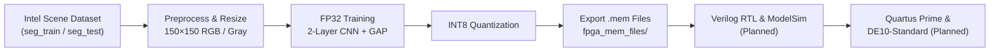

# CNN Natural Scene Classification Accelerator on Intel Cyclone V SoC FPGA

**Author:** Wijdan Insania Kuncoro  
**Target Hardware:** Terasic DE10-Standard (Intel Cyclone V SX SoC `5CSXFC6D6F31C6`)

An end-to-end hardware-software co-design repository implementing a **compact 6-class natural scene classifier** (*Intel Image Classification* dataset) targeting the **Terasic DE10-Standard** FPGA board. The software pipeline trains a lightweight 2-layer Convolutional Neural Network (`use_bias=False`) with Global Average Pooling and exports quantized INT8 weights (`.mem`) for on-chip M10K BRAM inference.

| Feature | Specification / Current Status |
|---|---|
| **Dataset** | Intel Image Classification (`150×150×3` RGB & Grayscale variants, 6 classes) |
| **CNN Topology** | 2-Layer Compact CNN (`conv1 → MaxPool → conv2 → MaxPool → GAP → dense_out`, `use_bias=False`) |
| **Total Parameters** | **`5,232` parameters** (`20.44 KB` in FP32 / **`~5.11 KB` in INT8**) |
| **Measured Test Accuracy** | **`82.53%`** (`2,476 / 3,000` images on `seg_test`) |
| **Exported Memory Artifacts** | `fpga_mem_files/` (RGB) & `fpga_mem_files_gray/` (Grayscale) `.mem` weight files |
| **Target Hardware Engine** | Sequential Time-Multiplexed MAC Engine on Cyclone V Fabric (Planned) |

---

## Contents

1. [Objectives](#1-objectives)
2. [Repository Layout](#2-repository-layout)
3. [Environment Setup](#3-environment-setup)
4. [Dataset](#4-dataset)
5. [CNN Architecture & Memory Footprint](#5-cnn-architecture--memory-footprint)
6. [Training & Evaluation Results](#6-training--evaluation-results)
7. [INT8 Quantization & `.mem` Export](#7-int8-quantization--mem-export)
8. [Target RTL Architecture (DE10-Standard)](#8-target-rtl-architecture-de10-standard)
9. [Milestone Status](#9-milestone-status)

---

## 1. Objectives

- Build a hardware-friendly **2-layer CNN with Global Average Pooling (GAP)** and **zero bias parameters (`use_bias=False`)** to minimize adder logic, ROM storage, and DSP usage on the Terasic DE10-Standard.
- Evaluate classification accuracy across 6 natural and urban scene categories (`buildings`, `forest`, `glacier`, `mountain`, `sea`, `street`) before and after fixed-point quantization.
- Export bit-accurate hexadecimal `.mem` files (`fpga_mem_files/` and `fpga_mem_files_gray/`) ready for `$readmemh` initialization in Verilog RTL and Quartus Prime synthesis.

## 2. Dataset and Setups
MIDTERM_FPGA/
└── dataset/
    ├── seg_train/               # Training split (~14,034 images)
    │   ├── buildings/
    │   ├── forest/
    │   ├── glacier/
    │   ├── mountain/
    │   ├── sea/
    │   └── street/
    ├── seg_test/                # Testing split (3,000 images)
    │   ├── buildings/
    │   ├── forest/
    │   ├── glacier/
    │   ├── mountain/
    │   ├── sea/
    │   └── street/
    └── seg_pred/                # Unlabeled prediction split (~7,301 images)

